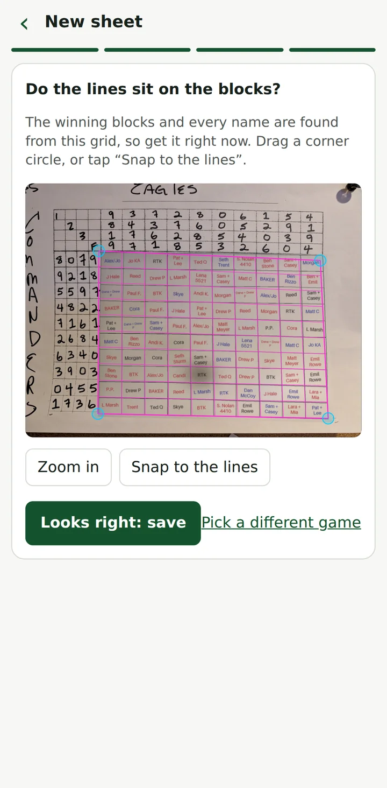
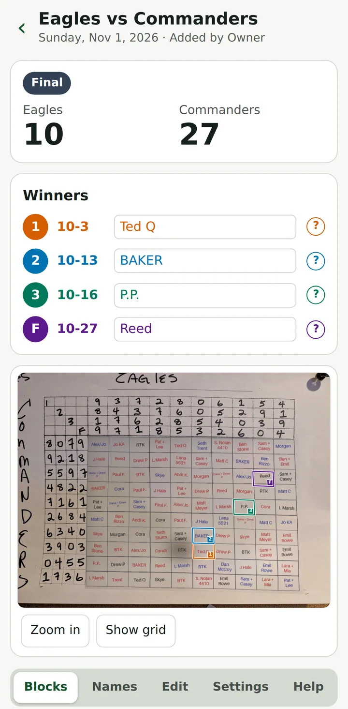

# Block Pool Checker

 

Check a football block pool from your phone. Photograph the handwritten 10x10 sheet, confirm the grid, and the app reads the teams, digits and names, finds the game, and shows the same photo with the winning blocks boxed. It follows the live score and says who is winning now.

  
  

Screenshots come from the offline demo mode (`READER=stub`) with a made-up sample sheet.

## What it does
- **Reads the sheet.** One call finds the teams, the digits and the grid corners; one call reads the 100 names. The reader only proposes: digits must be a 0-9 permutation or the app stops, and a name stays "?" until a person confirms it.
- **Shows the winners.** Four periods: end of the 1st quarter (**1**), halftime (**2**), end of the 3rd quarter (**3**) and final (**F**). Each winning block is boxed on the photo with its period number, so colour and text both carry the meaning.
- **Follows the game.** Scores come from ESPN with their source and time. A stored score is never shown as live, and a period still being played is "winning now", not a winner.
- **Runs a venue.** A lodge, bar or club gets one permanent QR code and a PIN. Runners post a sheet on the venue, add the photo once the digits are drawn, and publish it; people with the PIN watch the winners.
- **Keeps it private.** Photos show handwriting and phone numbers, so they are served only through the API. Viewers see names and winners, not the photo, unless a runner allows it.

## Who uses it
| You are | You can |
|---|---|
| **Owner** (one person) | Do everything: make venues and personal links at `/owner`, edit any sheet, restore or erase deleted sheets. |
| **Runner** | Post, photograph, check, publish, rename and delete the sheets of your venue; change its PIN. A venue has a main runner and backups, all equal. |
| **Viewer** | Scan the venue QR code, enter the PIN once, and watch the sheets. |

There is no sign-up and no viewer account. Access is a code or link, a PIN, or an edit link; [docs/HOW_IT_WORKS.md](docs/HOW_IT_WORKS.md#access) explains each and why.

## Documentation
**Using the app**
| Read | For |
|---|---|
| [docs/GUIDE.md](docs/GUIDE.md) | How to use it, by role (also the in-app Help page at `/help`) |
| [docs/PRIVACY.md](docs/PRIVACY.md) | The privacy policy: what is kept, who sees it, how long, and how the AI reads names (also `/privacy` in the app) |
| [docs/READER_RESULTS.md](docs/READER_RESULTS.md) | How well the app reads a sheet from a photo: a plain summary first, then the measurements |

**Building and running it**
| Read | For |
|---|---|
| [docs/DEVELOPING.md](docs/DEVELOPING.md) | What you need, running it locally, the code layout, project status |
| [docs/HOW_IT_WORKS.md](docs/HOW_IT_WORKS.md) | The pool rules, access model, reading, venues, stages and retention |
| [docs/GLOSSARY.md](docs/GLOSSARY.md) | The words the app, the docs and the code share |
| [docs/DEPLOY.md](docs/DEPLOY.md) | Production setup on Google Cloud, every env var |
| [CLAUDE.md](CLAUDE.md) | Conventions for working on the code with Claude Code |

## Status
Tested on phone and desktop with real sheets, and end to end offline. Some things are not yet verified (a real live game, the installed iPhone app): see [Project status](docs/DEVELOPING.md#project-status).

## License
[MIT](LICENSE). Contributions: [CONTRIBUTING.md](CONTRIBUTING.md). Security reports: [SECURITY.md](SECURITY.md). Conduct: [CODE_OF_CONDUCT.md](CODE_OF_CONDUCT.md).
