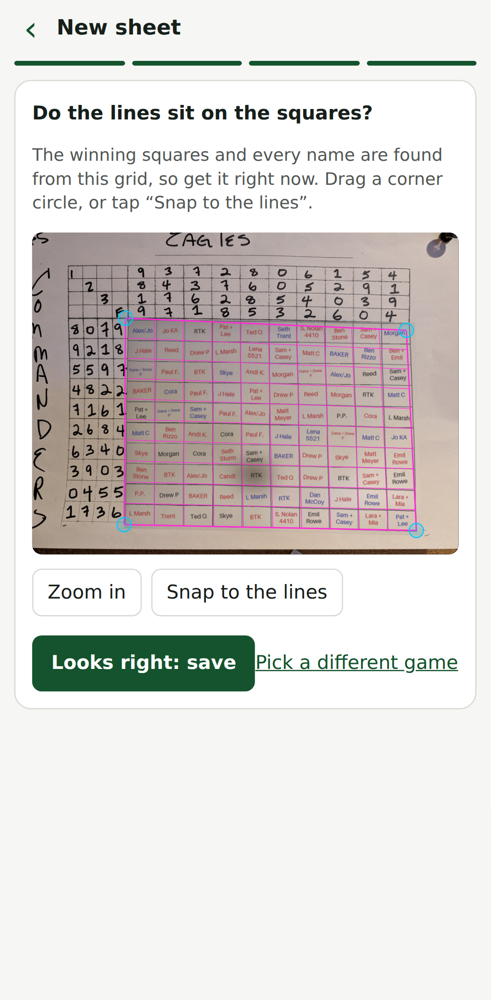
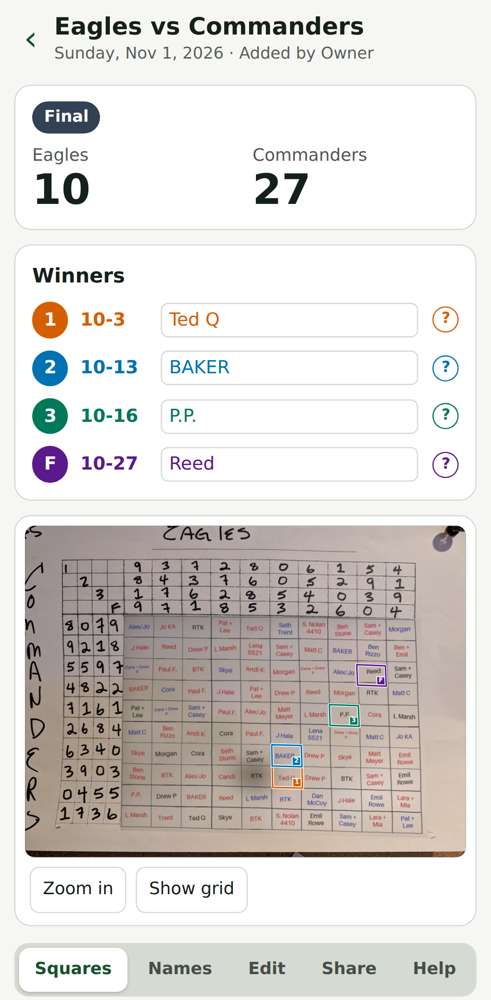

# Block Pool Checker

Installable, mobile-first PWA for checking football squares pools during the game. Photograph the handwritten 10x10 sheet, confirm the grid, and the app reads the teams, digits and names, finds the game, and shows the same photo with the winning squares boxed (each box carries its period number 1, 2, 3 or F; colours are chosen to work for colour-blind users), plus a short report that updates with the live score. Independent product: its own repo, GCP project, Firestore and storage. No dependency on Beventra.

<p>
  
  
</p>

Screenshots come from the offline demo mode (`READER=stub`) with a made-up sample sheet.

Start with `docs/PLAN.md` (product, decisions, status). Board rules are in `docs/POOL_FORMAT.md`; the production setup is in `docs/DEPLOY.md`.

## Layout
- `packages/engine`: Zod schemas and pure logic: winning squares, per-period results, grid geometry, the saved-sheet document (`SheetDoc`). Single source of truth for web and API. (Payout/`settle` code exists and is tested but no screen uses it.)
- `packages/scores`: `ScoreProvider` / `GameDirectory`, ESPN NFL adapter (unofficial API), manual provider.
- `packages/vision`: pure-TS image helpers and `snapGrid` (snap rough grid corners onto the printed lines).
- `services/api`: Hono API on Cloud Run: saved sheets (Firestore) and their private photos (Cloud Storage), personal access keys and the owner admin, name and photo reading (Gemini on Vertex AI), game and score routes. Serves the built web app.
- `apps/web`: Vite + React 19 PWA. `src/App.tsx` picks the page; pages in `src/pages/` (the sheet page and its sections in `src/pages/sheet/`), pieces shared by pages in `src/components/`, stateful logic in `src/hooks/`, pure logic and API clients in `src/lib/`.
- `samples/`: four sample pool photos the vision tests and e2e tests use. They started as real photos; the handwritten names were replaced with made-up ones and the grid lines redrawn (slightly wavy, shaded and noisy) at known corners, so they hold no real people's data. They are regression fixtures with known truth, not accuracy benchmarks: they prove the grid snapping and the app flow, not that handwriting is read well. The measured reading accuracy on real handwriting is in `docs/READER_RESULTS.md`. New photos here are git-ignored.
- `e2e/`: Playwright tests of the real flows, run offline against the stub reader.
- `docs/legacy/`: the original Custom GPT prototype spec and acceptance list (history only). `docs/READER_RESULTS.md`: the reader experiments behind the model choice.

## How it works
- **Access.** There is no sign-up. The owner holds the master code (`INVITE_CODE`, at least 20 random characters: `openssl rand -base64url 24`; the server refuses to start against real data with a shorter one) and makes a personal link per person at `/admin`. The key lives in the link; installing the app from that link makes a home-screen icon that opens signed in.
- **Sheets.** A sheet is saved on the server. `/s/<id>` views it; `/s/<id>#k=<edit token>` edits it (the token lives in the URL fragment, only its hash is stored). The person who made a sheet, and the owner, can also edit it through their key. Anyone who has a sheet's view link can see its photo and names (the link is the secret, so share it only with people in the pool); only editors see the marked squares ("mine"). A sheet is deleted 30 days after the game (or after its last edit, if later).
- **Reading.** One call reads the teams, digit rows and grid corners from the photo; one call reads every name from a straightened image of the grid. The model only proposes; digits must be a 0-9 permutation or it is a hard stop, and names stay "?" (unconfirmed) until a person confirms them.
- **Scores.** Fetched on demand with a ~20 s server cache; every score carries its source, status and `fetchedAt`, and a cached score is never shown as live.

## What you need
| To | You need |
|---|---|
| Run it locally, offline, free | Node 24, pnpm 11. No account, no keys: run the API with `READER=stub` (see Develop). |
| Read photos with a model | A Google Cloud project with the Vertex AI API on. The reader is Gemini 3.6 Flash (`gemini-3.6-flash`, minimal thinking) on the global Vertex endpoint, called with the service account's identity (no API key). Change it with `READER_MODEL` / `READER_THINKING`. Each sheet costs one photo read and one names read (a few thousand tokens each; see `docs/READER_RESULTS.md`). A per-sheet price has not been measured yet, so check your own billing; `READ_CAP_PER_DAY` limits each invited person. |
| Save sheets | Firestore (Native mode, a document database, no SQL) for sheets and people, and a private Cloud Storage bucket for photos. Locally the API keeps both in memory. |
| Host it | Cloud Run, one container (API plus the built web app). Steps and every env var: `docs/DEPLOY.md`. |
| Live scores | Nothing to sign up for: the ESPN scoreboard is used without a key. It is an unofficial API and may change without notice; the app then shows the last stored score marked "not live". |

## Develop
```bash
pnpm install
pnpm test        # unit tests, all packages
pnpm typecheck
pnpm lint        # ESLint; `pnpm format` runs Prettier
pnpm e2e         # Playwright against the built app with the stub reader (first: pnpm --filter @bpc/e2e install-browser)
pnpm --filter @bpc/api dev     # API on :8080, in memory (no GCP_PROJECT)
pnpm --filter @bpc/web dev     # web on :5173, proxies /api to :8080
```
For free UI testing run the API with `READER=stub`: recorded reader answers and a set of demo games between the sample sheet's teams (the recorded final, plus live in the 3rd quarter, halftime, not started and a final in overtime). Pick one under "Which game?" on a new sheet, or on an existing one under Edit > Change the game. It makes no model or network calls and costs nothing. Without `INVITE_CODE` the local API is open and every caller is the owner; set `INVITE_CODE=anything` to test access control.
